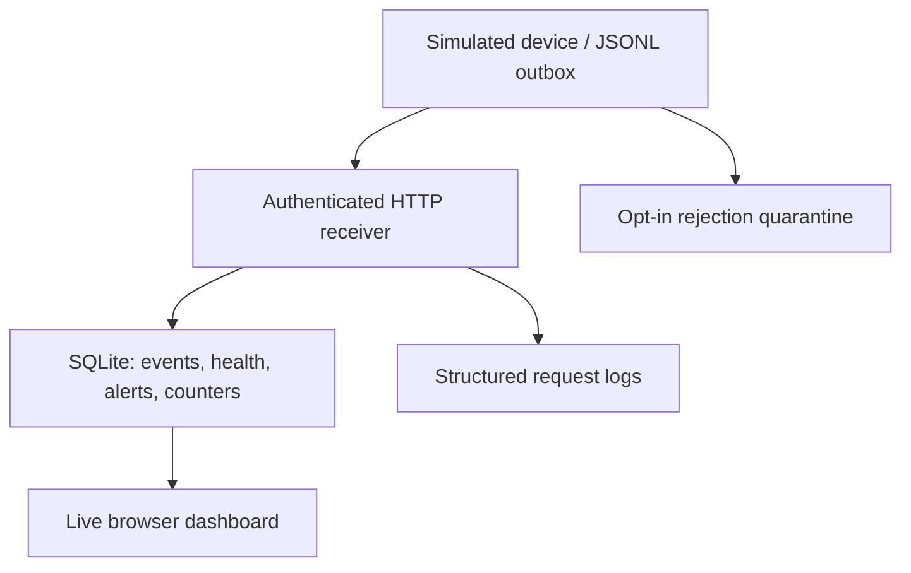

# EdgeWatch IoT

[](https://github.com/koushikchowdary6/edgewatch-iot/actions/workflows/ci.yml)

**A Python telemetry reliability lab that keeps readings through connectivity loss
and safely replays them after recovery.** An authenticated HTTP receiver stores
idempotent events, device health, alert history and ingestion counters in SQLite.
A live browser dashboard makes the recovery observable.

Software-only: the producer simulates a device. Alerts use deterministic thresholds;
there is no hardware integration, machine-learning model or deployed fleet claim.

## Quickstart: Run in 5 Minutes

Python **3.10+**, standard library only. From a terminal:

```bash
git clone https://github.com/koushikchowdary6/edgewatch-iot.git
cd edgewatch-iot
python demo.py
```

The demo uses a fresh `demo-data/` directory. Copy the **session API key printed in
the terminal**, open **http://127.0.0.1:8080**, enter the key and click **Connect**.
No key is stored in browser storage. Choose another directory/port to repeat:

```bash
python demo.py --output demo-repeat --port 8081
```

The demo actually starts the HTTP server, sends a reading, stops the server,
buffers three readings, fails delivery, restarts against the same database, replays,
and retries the accepted events again. Expected terminal evidence:

```text
OUTAGE: 3 readings retained in the device outbox
RECOVERED: {"stored_readings": 4, "stored_alerts": 1, "duplicate_retries": 3, "pending_outbox_lines": 0}
```

Inspect **4 stored readings**, **3 duplicate retries**, and the **72°C high-temperature
alert** on the dashboard. With the demo's short timeouts, health becomes stale after
5 seconds and offline after 15. Ctrl-C stops the server. The database and
`demo-result.json` remain for inspection. Server health reflects receipt of new events;
old buffered events arriving now can make receipt health fresh even if sensor time is old.

For an automated end-to-end run without leaving a server running:

```bash
python demo.py --no-serve --port 0 --output demo-ci
```

## Architecture



## Run the components separately

Set a local key of at least 16 ASCII characters in both terminals. Example for
bash/WSL; generate your own random value rather than reusing an example key:

```bash
export EDGEWATCH_KEY="$(python -c 'import secrets; print(secrets.token_hex(24))')"
python app.py --temperature-high 60 --voltage-low 3.2 --stale-seconds 30 --offline-seconds 120
```

In another terminal with **the same key**:

```bash
python replay.py --seed --outbox device.jsonl --attempts 3 --retry-delay 0.25
```

`--seed` refuses existing outboxes. To resend retained readings, omit `--seed`.
Retries are bounded (1–20 attempts; capped exponential delay). Authentication,
rate-limit, conflict and server failures stay queued. Optional
`--quarantine rejected.jsonl` moves HTTP 400/413 records aside before proceeding;
quarantine contains original telemetry and must stay local. One writer per outbox.

Replay reads only regular UTF-8 outbox files, rejects symlinks and named pipes
on supported POSIX systems, and caps an individual outbox at 8 MB. An oversized
or invalid queue is left untouched for inspection or rotation, never silently
drained or truncated. The opt-in quarantine must also be a regular file; symlink
quarantine targets are rejected on supported systems. These protections assume
a single local writer, not hostile concurrent filesystem mutation.

Sample POST `/api/samples` with `X-API-Key` and JSON:

```json
{"device":"sim-esp32","seq":42,"ts":"2026-01-01T00:00:00+00:00","temperature":72,"voltage":3.8}
```

First response is HTTP 201:

```json
{"accepted":true,"duplicate":false,"alert":"HIGH_TEMPERATURE"}
```

An identical retry returns HTTP 200 with `accepted:false, duplicate:true`.
A changed payload using the same device/sequence returns HTTP 400. Errors expose a
stable code and request ID; they never echo submitted values or credentials.
Authenticated `GET /api/overview` returns device health, the latest 200 readings,
100 alert events, persistent counters and active thresholds. `/healthz` is a
process-liveness probe; it does not certify storage readiness.

## Verified engineering behavior

- Atomic ingestion: event, device receipt time, alert evidence and accepted counter
  commit together. Concurrent retries serialize around the unique device/sequence key.
- Configurable, persistent alerts capture **the threshold at ingestion**; normal
  recovery readings do not erase history. Threshold changes do not invalidate replay.
- Ingestion receipt clocks and injected health-snapshot clocks must be timezone-aware `datetime` values; offsets are normalized to UTC. Naive local-time clocks are rejected rather than silently interpreted in the server's local timezone.
- Receipt-based health has healthy, stale, offline and unknown states. Migrated
  readings without receipt timestamps stay unknown; the system does not invent history.
- Strict finite measurements, timezone-aware timestamps, exact fields, duplicate-key
  rejection and a 4 KiB request budget. API authentication uses constant-time comparison
  and rejects duplicate API-key headers. Ingestion rejects duplicate/nondecimal
  Content-Length and Transfer-Encoding to avoid ambiguous HTTP request framing.
- Queue records are removed only after a valid bounded JSON acknowledgment.
  Unique, flushed staging files preserve the old outbox if replacement fails.
- JSON logs contain request ID, method, status and latency, **not** API keys or payloads.
  Dashboard counters distinguish stored events, duplicate retries and rejected POSTs.

## Tests and CI

```bash
python -m unittest discover -s . -v
```

The regression suite covers concurrent duplicate delivery,
restart persistence, receipt-clock health, rule changes, invalid JSON, auth/error
contracts, replay write failures, bounded retry and a real HTTP outage/reconnect demo.
[GitHub Actions](https://github.com/koushikchowdary6/edgewatch-iot/actions/workflows/ci.yml)
runs the suite on Python 3.10 and 3.12. The badge reflects main, not an unmerged branch.

## Engineering decisions and tradeoffs

The hard part is keeping a transport retry from becoming a duplicate side effect,
and distinguishing sensor event time from receiver receipt time. A unique key plus a
SQLite transaction provides one stored row per event, not exactly-once transport.
The outbox is single-writer; server acceptance before a client crash can cause replay,
which ingestion deduplicates. A quarantine append can be repeated after a crash.

SQLite and the standard library make the demo reproducible without services, Docker
or cloud credentials. They trade fleet scale, per-device identity and production HTTP
hardening for inspectability. This server binds localhost, sets body/socket limits,
and uses a shared API key. It lacks TLS, rate limiting, key rotation, device provisioning,
background workers and retention policies. Do not expose it directly to the internet.
The dashboard cannot know client outbox depth. Its trend mixes recent devices; it is
an illustrative received-temperature trend, not a per-device analytical chart.
The fsynced staging file and atomic rename do not promise power-loss durability of
parent directories. Thresholds are illustrative, not battery safety advice.

## How I'd explain this in an interview

“I built a small receiver and device outbox to make failure handling visible.
I can stop delivery, preserve events, restart the receiver, replay twice and show
that readings and alert history remain deduplicated. The key design choices are
transactional ingestion, receipt-based health, and explicit acknowledgment validation.”

## Provenance

[PROVENANCE.md](PROVENANCE.md) records the upstream migration and AI-assisted
implementation history. Existing license notices are retained. No hardware test
results, production availability measurements or ML accuracy are claimed.
